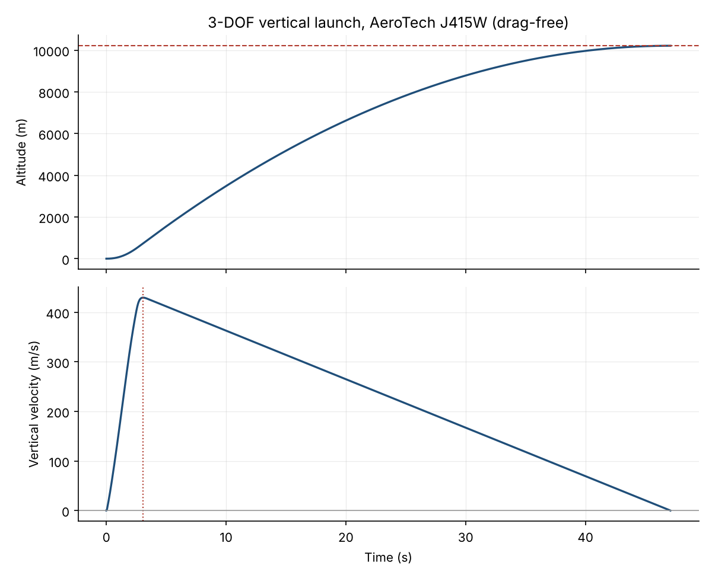

# rocket-sim

A 3-DOF flight simulator for high-power rockets, written in C++17.

**Status:** in progress (Nov 2026). Vertical flight from launch to apogee runs,
but it hasn't been checked against the closed-form drag-free solution yet.



*Vertical launch on an AeroTech J415W. No drag, and the airframe mass is a 2 kg
placeholder.*

## What it models today

| Model | Implementation |
|---|---|
| Integration | Generic 4th-order Runge-Kutta, templated over any state type supporting `+` and scalar `*` |
| Propulsion | RASP `.eng` thrust curves, linearly interpolated |
| Mass | Propellant mass drops in proportion to impulse delivered |
| Gravity | Inverse-square with altitude |
| Atmosphere | US Standard Atmosphere 1976, 7 layers to 71 km, with geopotential correction |
| Flight | Vertical launch integrated to apogee, 1-D motion carried in a 6-element 3-D state vector |

## Not modeled yet

- Aerodynamic drag
- Attitude (the state is translation only)
- Control
- Descent (integration stops at apogee)
- Airframe (mass is a 2 kg placeholder)
- Wind, Mach, speed of sound

## Tests

| File | Checked against |
|---|---|
| `rk4_tests.cpp` | Closed-form harmonic oscillator, within 1e-5. Halving the step cuts error by a factor between 12 and 20 (theory: 16) |
| `motor_tests.cpp` | Hand-computed thrust interpolation, within 1e-6 |
| `environment_tests.cpp` | US Standard Atmosphere 1976 densities at 6 altitudes, within 1e-3 kg/m³, and gravity at 0, 10 and 100 km |

After building (below), run the 11 tests with:

```sh
ctest --test-dir build -C Debug --output-on-failure
```

## Build

CMake fetches Eigen 3.4.0 and GoogleTest 1.14.0 with `FetchContent`. You need
CMake 3.16+ and a C++17 compiler.

```sh
cmake -B build -S .
cmake --build build --config Debug
```

## Run

The motor file is loaded by a path relative to the working directory, so run
from the repository root:

```sh
./build/Debug/3_dof_sim.exe flight.csv   # Windows / MSVC
./build/3_dof_sim flight.csv             # Linux / macOS
```

This writes `t_s,altitude_m,velocity_ms` to `flight.csv` and prints the apogee
to stderr. To regenerate the figure above:

```sh
python scripts/plot.py flight.csv -o docs/img/flight.png
```

The plotting script needs matplotlib. The simulator doesn't use Python.

## Repository layout

```
include/            headers, one directory per subsystem
  math/             rk4_integrator.hpp   header-only, templated
  vehicle/          motor.hpp
  dynamics/         environment.hpp
src/
  sim/              3_dof_sim.cpp        the flight driver
  vehicle/          motor.cpp
  dynamics/         environment.cpp
tests/              one GoogleTest file per subsystem
config/             motor data (RASP .eng)
scripts/            plot.py
docs/img/           figures used by this README
```

## References

- Thrust curve data: [ThrustCurve.org](https://www.thrustcurve.org), converted
  from Tripoli TMT test-stand data (1998).
- *U.S. Standard Atmosphere, 1976*, NOAA/NASA/USAF.
- [Eigen](https://eigen.tuxfamily.org) for linear algebra,
  [GoogleTest](https://github.com/google/googletest) for testing.

## License

MIT. See [LICENSE](LICENSE).